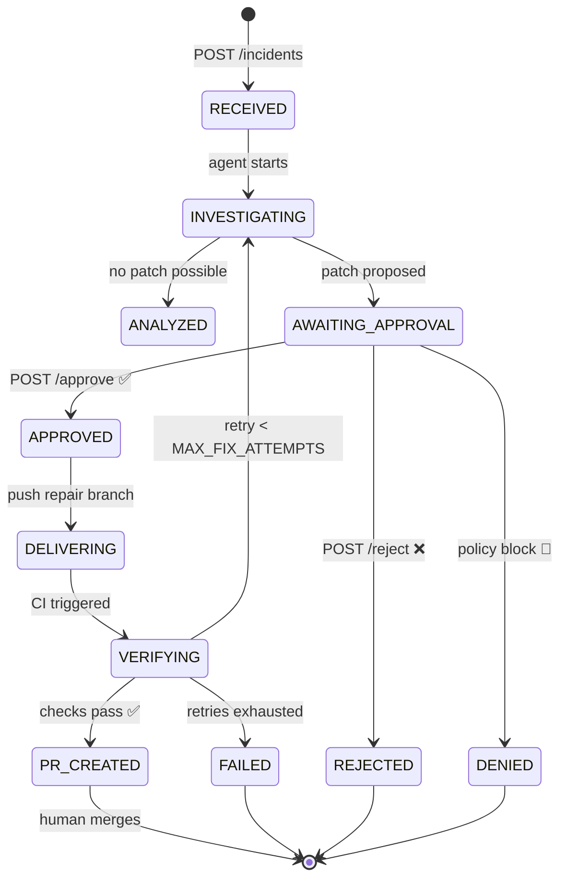
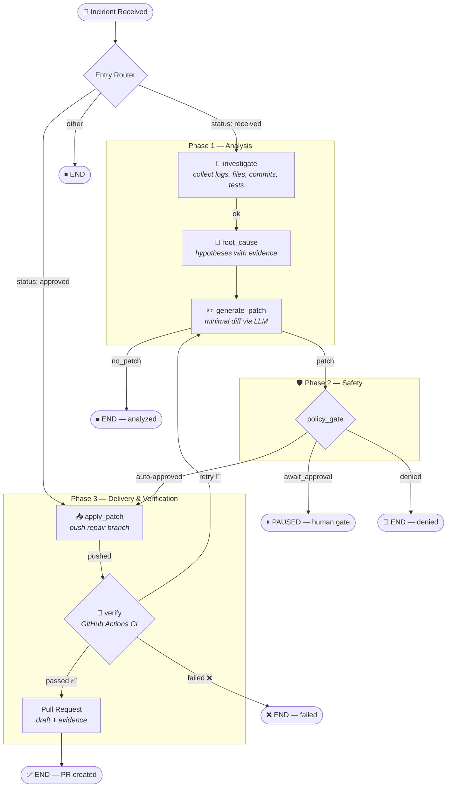
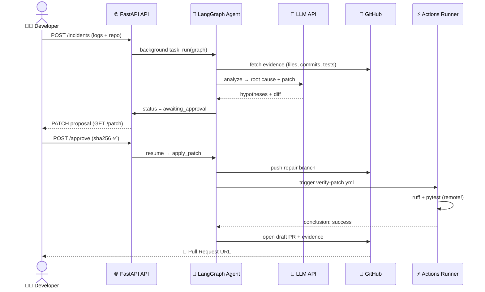
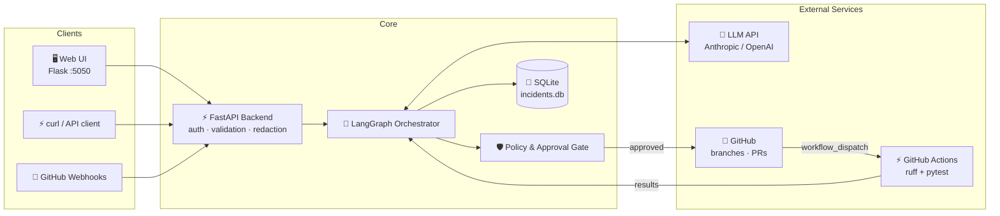
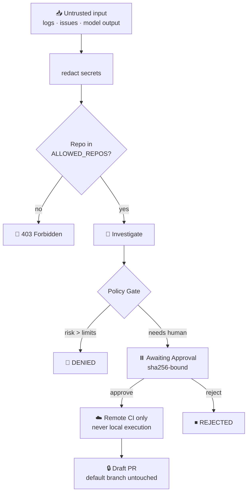

<div align="center">

# 🤖 Multi Agent AI SRE Workflow

### *An Agentic AI system that investigates incidents, proposes patches, verifies them in CI — and delivers fixes through Pull Requests.*

[](https://www.python.org/)
[](https://fastapi.tiangolo.com/)
[](https://langchain-ai.github.io/langgraph/)
[](#-testing)
[](https://docs.astral.sh/ruff/)
[](#-docker-free)
[](#-license)

[**Overview**](#-overview) •
[**Workflow**](#-workflow) •
[**Architecture**](#️-architecture) •
[**Quick Start**](#-quick-start) •
[**API**](#-api-reference) •
[**Roadmap**](#-roadmap)

</div>

---

## 📌 Overview

The **AI SRE Agent** connects to an authorized GitHub repository, investigates an incident
using evidence (logs, stack traces, code, tests), forms a root-cause hypothesis, proposes a
**focused patch**, verifies it on a **remote GitHub Actions runner**, and opens a **draft Pull
Request** — with a mandatory **human approval gate** before anything is ever delivered.

> **Status:** Working MVP — core Phases 1–4 implemented, **33 automated tests**.
> **Safety first:** AI-generated code is never executed on your machine; verification happens
> remotely in a restricted CI workflow.

### ✨ Highlights

| | |
|---|---|
| 🔍 **Evidence-driven** | Every hypothesis cites concrete evidence — logs, files, commits, tests |
| 🧠 **LLM-optional** | Works offline with heuristic analysis; add an API key for AI patches |
| 🚧 **Human-in-the-loop** | Approval gate with SHA-256 patch binding — nothing ships unreviewed |
| 🏝️ **Local mode** | `local:` repos let you test everything with zero GitHub setup |
| 🔒 **Least privilege** | Allowlisted repos, secret redaction, bounded retries, no local code exec |
| 🐳 **Docker-free** | Plain `venv` + `pip` — no containers required |

---

## ⚙️ Workflow

### 🔁 Incident Lifecycle (State Machine)



### 🔀 Agent Orchestration Graph (LangGraph)



### 🌐 End-to-End Sequence



---

## 🏗️ Architecture



### 📂 Repository Structure

```text
ai-sre-agent/
├── 📁 app/                        # Backend application
│   ├── main.py                    # FastAPI entrypoint (create_app)
│   ├── config.py                  # Pydantic settings (.env driven)
│   ├── 📁 agent/                  # LangGraph orchestration
│   │   ├── graph.py               #   state machine wiring
│   │   ├── runner.py              #   crash-safe graph executor
│   │   ├── prompts.py / patching.py / state.py
│   │   └── 📁 nodes/              #   investigate · root_cause ·
│   │                              #   generate_patch · policy_gate ·
│   │                              #   apply_patch · verify · open_pr
│   ├── 📁 api/                    # REST routes
│   │   ├── routes_incidents.py    #   incidents CRUD + patch view
│   │   ├── routes_approvals.py    #   approve / reject (human gate)
│   │   └── webhooks.py            #   validated GitHub events
│   ├── 📁 integrations/           # External services
│   │   ├── github_client.py       #   GitHub App / token + local repos
│   │   ├── llm_client.py          #   Anthropic / OpenAI (auto-detect)
│   │   └── test_runner.py         #   remote CI trigger + polling
│   ├── 📁 security/               # Guardrails
│   │   ├── policies.py            #   repo allowlist · risk limits
│   │   ├── approvals.py           #   SHA-256 bound approvals
│   │   └── redaction.py           #   secret scrubbing from logs
│   ├── 📁 schemas/incident.py     # Typed Pydantic models
│   └── 📁 storage/incidents.py    # SQLite persistence + audit events
├── 📁 frontend/                   # Flask web UI (:5050)
├── 📁 tests/                      # 33 tests — units · e2e · frontend
├── 📁 examples/sample_app/        # Offline demo repo + incident.json
├── 📁 .github/workflows/          # verify-patch.yml (CI template)
├── 📄 .env.example                # Configuration template
├── 📄 requirements.txt            # Pinned runtime deps
└── 📄 requirements-dev.txt        # pytest · ruff · flask
```

---

## 🛠️ Technology Stack

| Layer | Technology | Purpose |
|:--|:--|:--|
| 🐍 Language | **Python 3.12+** | Backend & agent implementation |
| 🤖 Orchestration | **LangGraph** | Stateful graph, checkpointing, pause/resume |
| ⚡ API | **FastAPI + Uvicorn** | Async endpoints, background agent runs |
| 🔍 Validation | **Pydantic v2** | Typed schemas & settings |
| 🧠 Model | **Anthropic / OpenAI** (auto-detect) | Root-cause reasoning & patch generation |
| 🐙 Repo Access | **GitHub App / fine-grained token** | Branches, diffs, PRs, webhooks |
| ⚡ CI | **GitHub Actions** | Remote, sandboxed patch verification |
| 💾 Storage | **SQLite** | Incidents, events, audit trail |
| 🖥️ Frontend | **Flask** | macOS-style review dashboard |
| 🧪 Testing | **Pytest** | Unit + workflow e2e + frontend tests |
| ✨ Linting | **Ruff** | Fast Python linter & formatter |

---

## 🚀 Quick Start

### Prerequisites

- Python **3.12+** · Git · (optional) GitHub account & LLM API key
- **No Docker required** 🎉

### 1 · Setup

```powershell
# Clone & enter
git clone https://github.com/<your-user>/ai-sre-agent.git
cd ai-sre-agent

# Virtual environment
py -m venv .venv
.\.venv\Scripts\Activate.ps1        # PowerShell
# .venv\Scripts\activate.bat        # CMD (if execution policy blocks you)

# Install dependencies
pip install -r requirements-dev.txt

# Configure
copy .env.example .env              # then edit with your keys
```

### 2 · Test

```powershell
python -m pytest -q          # ✅ 33 tests — no network needed
ruff check .                 # ✅ lint clean
```

### 3 · Run

```powershell
# Terminal 1 — API (http://127.0.0.1:8000)
uvicorn app.main:create_app --factory --reload

# Terminal 2 — Web UI (http://127.0.0.1:5050)
python frontend/app.py
```

### 4 · Try it offline (no GitHub, no API key) 🏝️

With `ALLOWED_REPOS=local:sample_app` in `.env`:

```powershell
curl -X POST http://127.0.0.1:8000/incidents `
  -H "content-type: application/json" `
  -d "@examples/sample_app/incident.json"

curl http://127.0.0.1:8000/incidents/<id>
```

| Configuration | What you get |
|:--|:--|
| No `LLM_API_KEY` | Evidence collection + **heuristic** root cause |
| With `LLM_API_KEY` | + AI root cause & proposed diff at `GET /incidents/<id>/patch` |
| `local:` repos | Read-only — approved patches shown for manual `git apply` |

### 5 · Real GitHub flow 🐙

1. Create a **GitHub App** (or a fine-grained token for *one* test repo) with:
   `Contents: write` · `Pull requests: write` · `Actions: write` · `Metadata: read`
2. Copy `.github/workflows/verify-patch.yml` to the **default branch** of the target repo
3. Set `ALLOWED_REPOS=owner/repo` in `.env`
4. Flow: submit incident → `awaiting_approval` → `POST /incidents/<id>/approve`
   with the patch's `sha256` → repair branch → remote CI → **draft Pull Request**
   (a failed CI run triggers a new patch needing fresh approval, up to `MAX_FIX_ATTEMPTS`)

---

## 📡 API Reference

<details>
<summary><b>Click to expand all endpoints</b></summary>

| Method | Endpoint | Description |
|:--|:--|:--|
| `POST` | `/incidents` | Submit an incident → agent starts in background **(202)** |
| `GET` | `/incidents` | List recent incidents |
| `GET` | `/incidents/{id}` | Full incident record (status, evidence, hypotheses) |
| `GET` | `/incidents/{id}/patch` | Proposed patch — diff, rationale, `sha256`, risk |
| `GET` | `/incidents/{id}/events` | Audit trail of every agent action |
| `POST` | `/incidents/{id}/approve` | ✅ Approve a patch — **requires its exact `sha256`** |
| `POST` | `/incidents/{id}/reject` | ❌ Reject a patch with a comment |
| `POST` | `/webhooks/github` | Validated GitHub webhook receiver |
| `GET` | `/health` | Liveness probe |

</details>

<details>
<summary><b>Example: submit → approve → PR</b></summary>

```bash
# 1️⃣ Submit
curl -X POST localhost:8000/incidents -H "content-type: application/json" \
  -d '{"title":"stats bug","repository":"local:sample_app","logs":"..."}'
# → {"id":"abc123","status":"received"}

# 2️⃣ Watch it pause at the gate
curl localhost:8000/incidents/abc123
# → status: awaiting_approval, patch.sha256: "9f86d0..."

# 3️⃣ Approve (the sha256 binds approval to THIS exact patch)
curl -X POST localhost:8000/incidents/abc123/approve \
  -H "content-type: application/json" \
  -d '{"approver":"me","patch_sha256":"9f86d08219..." }'

# 4️⃣ Collect the PR
curl localhost:8000/incidents/abc123
# → pull_request_url: "https://github.com/.../pull/1"
```

</details>

---

## 🛡️ Security & Guardrails



-   **Least privilege** — GitHub App scoped to selected repositories only
-   **No local code execution** — AI-generated patches never run on your machine
-   **Remote verification** — restricted, predefined GitHub Actions workflow (read-only token, no secrets, 10-min timeout)
-   **Secret redaction** — logs/test output scrubbed before storage
-   **SHA-256 approval binding** — approving one patch cannot approve a swapped-in patch
-   **Repo allowlist** — only `ALLOWED_REPOS` can ever be touched
-   **Bounded retries** — `MAX_FIX_ATTEMPTS`, `MAX_LLM_CALLS_PER_INCIDENT`, CI timeouts
-   **Audit trail** — every action recorded in `/incidents/{id}/events`
-   **Default branch is sacred** — agent only pushes to dedicated repair branches

---

## 🧪 Testing

```powershell
python -m pytest -q        # 33 tests: units · workflow e2e · frontend
```

| Suite | Covers |
|:--|:--|
| `test_units.py` | Schemas, policies, redaction, approvals, storage |
| `test_workflow_e2e.py` | Full graph runs: analyze → gate → patch → verify |
| `test_frontend.py` | Flask UI routes & API proxying |

---

## 🐳 Docker-Free Development

Docker is **intentionally excluded**. Local isolation uses Python's built-in `venv`;
remote testing uses GitHub Actions hosted runners. This keeps the project runnable on
any machine with just Python + Git.

> ⚠️ `venv` is a dependency isolation tool, **not** a security sandbox. Never treat it as one.

---

## 🗺️ Roadmap

| Phase | Focus | Status |
|:--|:--|:--:|
| **1** | Working local MVP — API, schemas, LangGraph, patch proposals | ✅ |
| **2** | GitHub integration — repair branches, diffs, PRs | ✅ |
| **3** | Remote verification — Actions workflow, bounded retries | ✅ |
| **4** | Review interface & persistence — Flask UI, audit log | ✅ |
| **5** | Monitoring & controlled remediation — OTel, health checks, rollback | 🔜 |

### 🔜 Future Improvements

-   Incident deduplication & severity classification
-   Additional CI providers and repo platforms
-   Prometheus metrics & OpenTelemetry tracing
-   Role-based access control & richer approval policies
-   Deployment health checks and tested rollback workflows
-   Benchmarked repair success rate / cost-per-incident metrics

---

## ⚠️ Limitations

-   Root-cause analysis and patches **can be wrong** — human review remains mandatory
-   Passing tests don't prove production safety
-   The agent only sees repositories it's authorized to access
-   Hosted LLM APIs and CI runners require internet & may incur costs
-   Deployment / self-healing automation is future work (Phase 5)

---

## 🤝 Contributing

1.  Open an issue describing the change
2.  Add or update tests
3.  Run `ruff check .` and `python -m pytest -q`
4.  Document security-sensitive changes
5.  Submit a Pull Request

> 🚫 Never commit real secrets, sensitive logs, or credentials in issues, commits,
> test fixtures, or PRs.

---

## 📄 License

No license selected yet — add a `LICENSE` file before distributing or accepting
external contributions.

---

<div align="center">

**Built with  FastAPI · LangGraph · GitHub Actions · Pytest · Ruff**

*If this project helped you, consider giving it a ⭐ on GitHub!*

</div>
